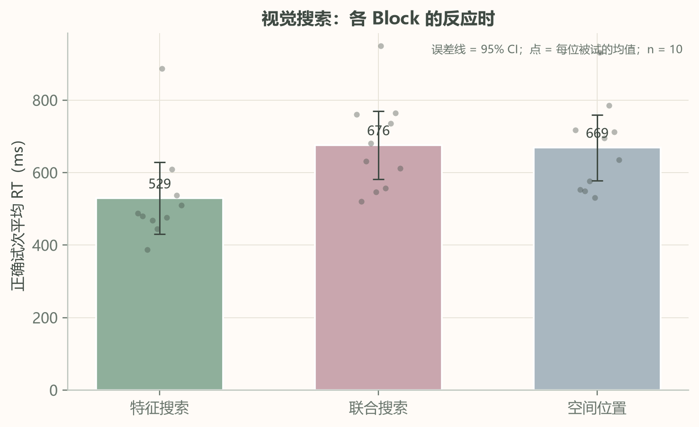
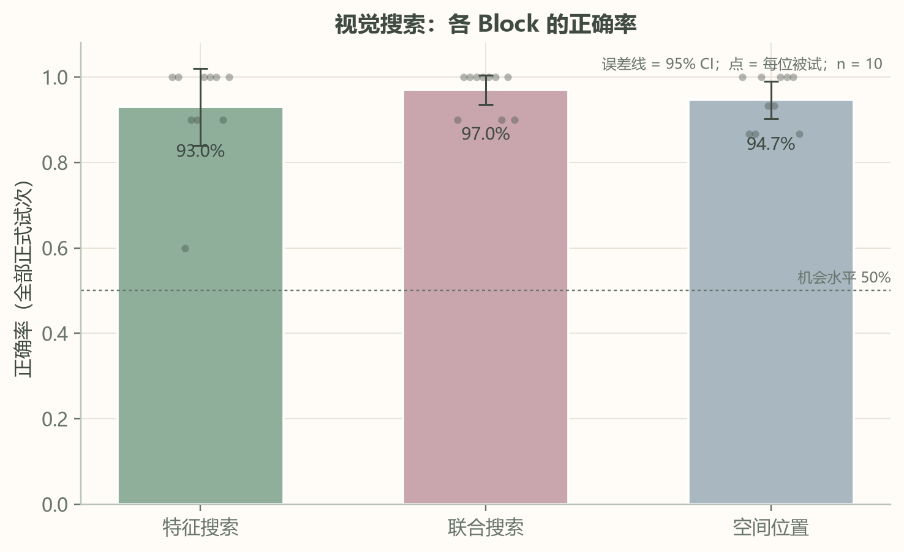
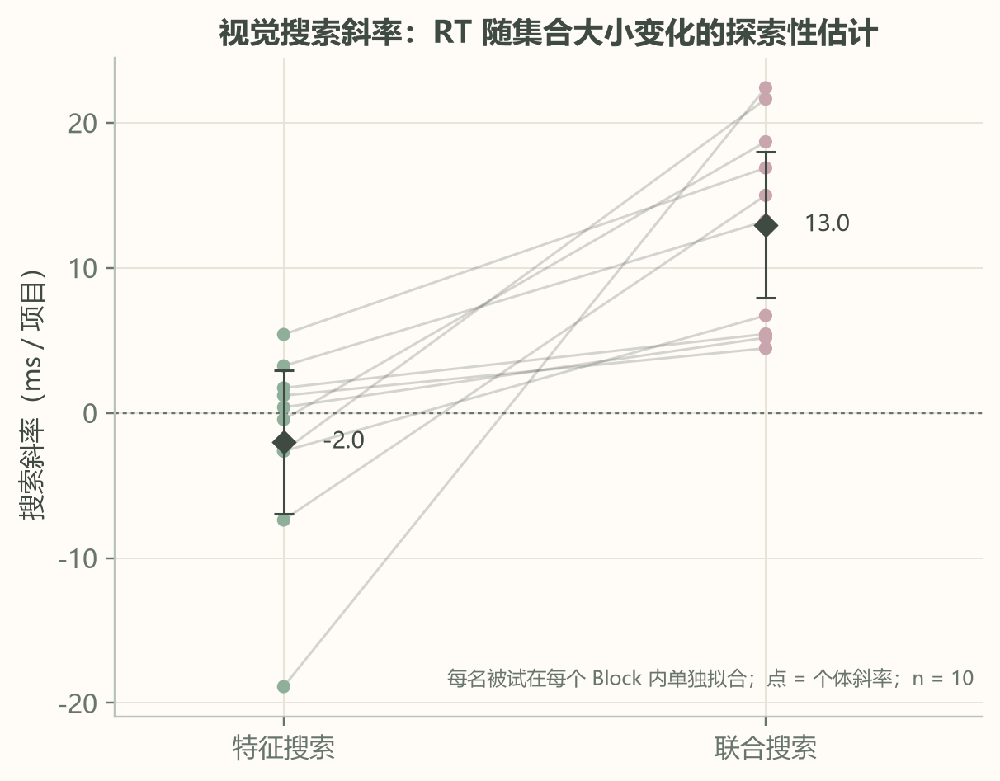
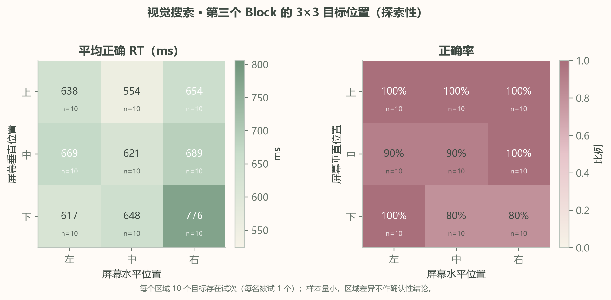
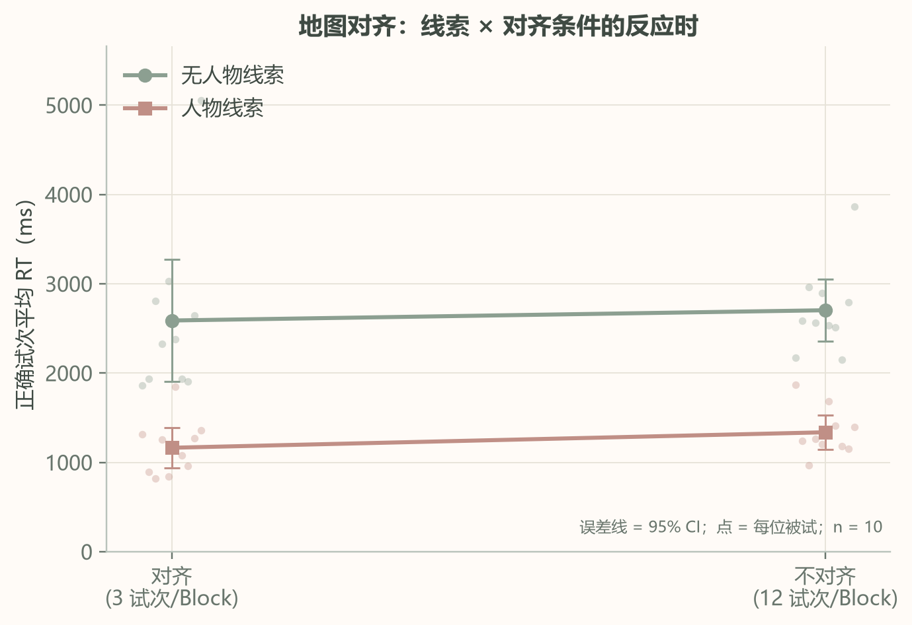
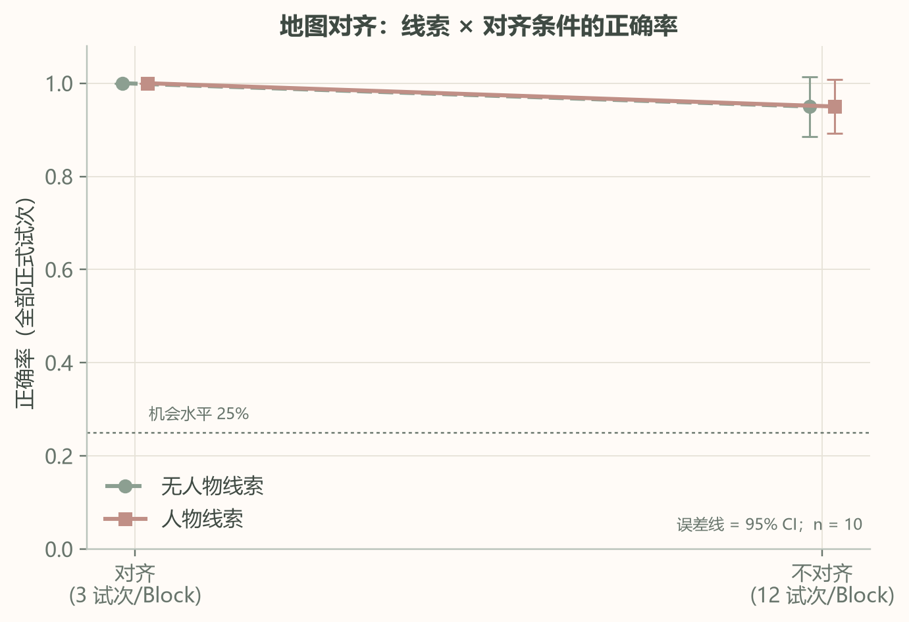
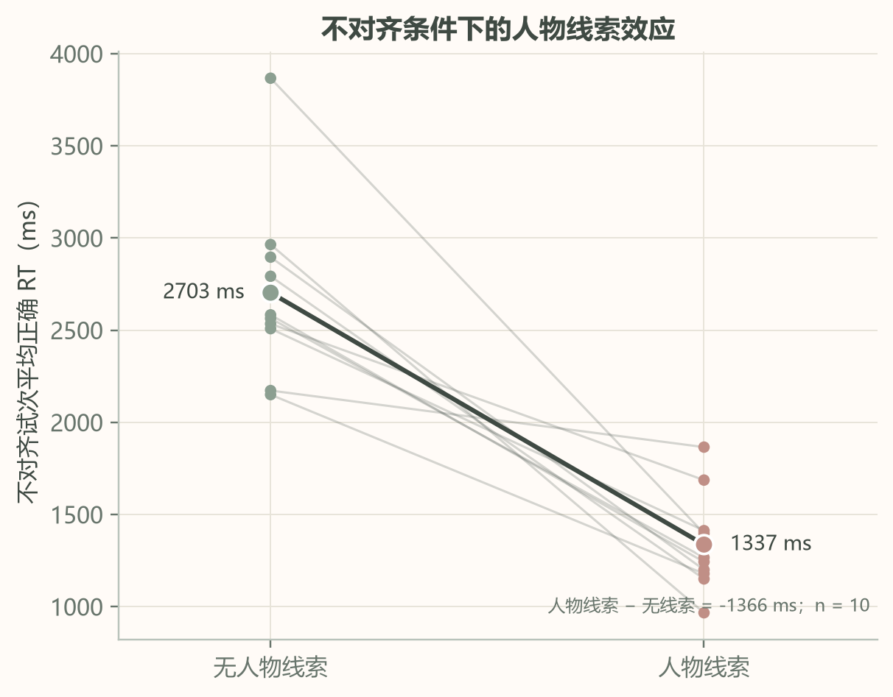
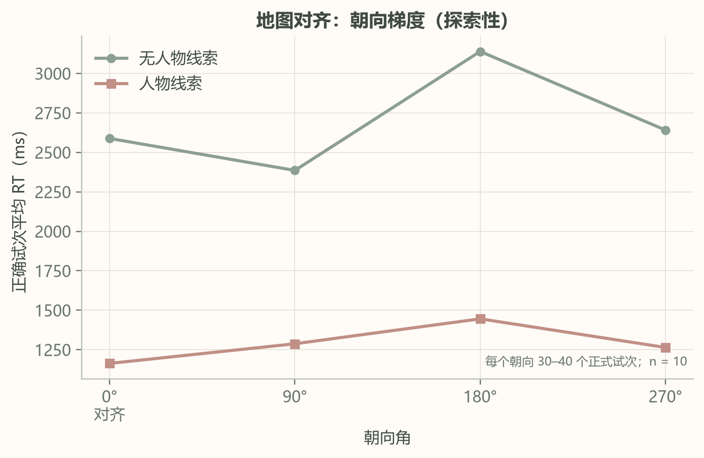

# 作业 2 · Dreamy Attention Lab（梦境注意实验室）

本目录是课程作业 2 的提交版本。项目实现了一个可在浏览器中运行的在线认知心理学实验平台，当前向被试开放两项实验：

1. **视觉搜索（Visual Search）**
2. **地图对齐（Map Alignment）**

平台包含被试入口、练习与正式试次、独立 Block、逐试次数据记录、可选摄像头注视估计、离线重传、研究者后台、结果页和 CSV / JSON 导出。

- **在线实验地址**：<https://web-production-e1f4a.up.railway.app>
- **技术栈**：React 19 + TypeScript + Vite + Tailwind CSS；Express；SQLite（Node 内置 `node:sqlite`）
- **运行环境**：Node.js ≥ 22.5（开发与验证使用 Node 24.20）
- **说明**：本提交包含代码、配置、文档、分析脚本与匿名聚合结果，不包含任何原始参与者数据、逐试次数据、数据库、`.env` 或密钥。

---

## 1. 项目概述

Dreamy Attention Lab 是一个研究用途的浏览器实验平台。视觉风格与正式刺激区域分离：正式试次只保留刺激、问题、按键提示和必要的流程信息，不使用装饰性动画、动态背景或无关弹窗。

平台的设计目标是：

- 让被试可以在普通桌面浏览器中完成实验；
- 把练习与正式试次、原始 Block 与扩展 Block 明确分开；
- 逐试次保存刺激参数、反应、正确性和反应时；
- 对浏览器计时与 WebGazer 注视估计的效度边界作明确说明；
- 不伪造数据、不把鼠标轨迹当作眼动、不把探索性指标写成确定性结论。

> **重要边界**：这是浏览器行为实验平台，不是经过光电二极管校准的实验室呈现系统。刷新率、设备性能、浏览器合成路径与系统缩放都会进入计时误差。WebGazer 的注视估计是探索性近似测量，原始视频不会上传或保存。

---

## 2. 当前开放的实验

被试入口只开放以下两项。`perceptual-ordering`（图形知觉排序）的代码与数据库类型仍保留，用于历史会话兼容，但已不在当前被试目录中开放，因此本作业不把它作为正式数据收集任务。

### 2.1 视觉搜索（Visual Search）

**任务**：判断字母阵列中是否存在一个**红色、正立的字母 O**。

| 项目 | 设置 |
| --- | --- |
| 目标 | 红色 `O` |
| 反应键 | `F` = 存在；`J` = 不存在 |
| 集合大小 | 4、8、16、24 |
| 网格 | 10 列 × 6 行，单元内加入轻微抖动 |
| 练习 | 每个 Block 2 个练习试次（不计入正式分析） |
| 反应时限 | 4000 ms |
| 正式试次 | Block 1：10；Block 2：10；Block 3：15 |
| 反馈 | 正式试次无逐试次对错反馈 |

三个 Block 依次进行：

1. **Block 1 · 特征搜索（颜色）**  
   干扰项为蓝色 `O` 与蓝色 `X`。目标在颜色上是唯一的，理论上可以进行颜色特征搜索。
2. **Block 2 · 联合搜索（颜色 × 形状）**  
   干扰项为红色 `X` 与蓝色 `O`。目标需要同时满足“红色”和“O”两个特征，理论上需要特征绑定。
3. **Block 3 · 空间位置搜索**  
   目标仍为红色 `O`，干扰项为红色 `X` 与蓝色 `O`。默认 15 个正式试次中，9 个目标存在试次覆盖 3 × 3 的九个区域各一次，另外 6 个为目标缺席试次；区域效应只作描述性、探索性分析。

**记录内容**：按键、正确性、反应时、集合大小、目标是否存在、目标区域、逐项字母坐标，以及可选的鼠标轨迹和 WebGazer 注视估计。

**关于斜率**：Block 1 和 Block 2 各只有 10 个正式试次，分配到 4 个集合大小 × 2 种目标存在性后，单个条件单元只有 1–2 个试次。平台仍可在至少两个集合大小有正确试次时拟合探索性斜率，但这种斜率不稳定，必须标注为探索性，不能当作稳定的搜索斜率估计。

**眼动与鼠标**：视觉搜索支持可选的 WebGazer 注视估计。被试在练习后单独同意才会请求摄像头；拒绝或摄像头不可用时实验继续。注视样本与鼠标轨迹分别存储、分别分析，不会合并成一条“真实扫描轨迹”。鼠标轨迹只是行为代理，不是眼动数据。

### 2.2 地图对齐（Map Alignment）

**任务**：阅读一张方向固定的俯视校园地图中央的位置标记，判断金圈标出的目标建筑相对于“你当前面朝方向”的方位。

#### 固定地图

地图方向固定，建筑位置固定：

| 建筑 | 屏幕位置 | 世界方位 |
| --- | --- | --- |
| 实验楼 | 上 | 0° |
| 食堂 | 右 | 90° |
| 图书馆 | 下 | 180° |
| 教学楼 | 左 | 270° |

地图、建筑标签、指南针在试次之间都不旋转。每个试次变化的是被试的**朝向**，而不是地图。

#### 两种线索条件

| Block | 条件 | 中央线索 |
| --- | --- | --- |
| `ma_no_cue` | 无人物线索 | 普通红色位置圆点 |
| `ma_person_cue` | 人物线索 | 俯视小人，头部与身体指向当前朝向 |

两个 Block 的顺序按参与者编号在被试间平衡。每个 Block 先做 2 个练习试次，再做 15 个正式试次。

#### 朝向与对齐

- `headingDeg = 0°`：面朝屏幕上方（实验楼），为 **aligned（对齐）**。
- `headingDeg = 90° / 180° / 270°`：分别面朝屏幕右方（食堂）、下方（图书馆）、左方（教学楼），为 **misaligned（不对齐）**。

每个 Block 的 15 个正式试次都包含四种朝向，次数为 0° = 3、90° = 4、180° = 4、270° = 4；对齐试次 3 个，不对齐试次 12 个。

#### 正确答案的计算

正确答案由目标建筑的实际屏幕方位减去当前朝向得到：

```text
relative = normalizeDegrees(targetBearingDeg - headingDeg)
0°   = 前方
90°  = 右方
180° = 后方
270° = 左方
```

其中 `targetBearingDeg` 使用固定地图中的建筑方位（实验楼 0°、食堂 90°、图书馆 180°、教学楼 270°）。人物线索只改变中央图形的外观，不改变题目或正确答案。

正式试次中，目标建筑从不等于当前面朝的建筑，因此正确答案只可能是右方、后方或左方；“前方”按键保留用于练习和键盘映射完整性。

四个可核查的例子：

| 当前朝向 | 目标建筑 | 目标相对方向 |
| --- | --- | --- |
| 0°（面朝实验楼） | 食堂 | 右方 |
| 90°（面朝食堂） | 教学楼 | 后方 |
| 180°（面朝图书馆） | 教学楼 | 右方 |
| 270°（面朝教学楼） | 实验楼 | 右方 |

**反应**：方向键，`↑` 前方、`↓` 后方、`←` 左方、`→` 右方。地图、朝向文字和问题同时出现，出现后即可作答；默认没有反应时限。正式试次无逐试次对错反馈。

**记录内容**：朝向角、地图旋转（固定为 0）、线索条件、目标建筑、目标方位、正确方向、按键、正确性、反应时、练习/正式阶段、Block 顺序和注意力监测字段。

**结果分析**：按真实朝向角区分 aligned / misaligned；比较无人物线索与人物线索条件下的正确率和正确反应时；计算不对齐代价（misaligned − aligned）；并描述线索 × 对齐条件的交互。所有分析以参与者为单位汇总，练习试次不进入正式统计。

### 2.3 图形知觉排序（归档，不开放在被试入口）

代码中仍保留 `perceptual-ordering` 的生成器、任务与历史数据类型，用于读取旧会话；当前 `ACTIVE_EXPERIMENT_IDS` 只包含视觉搜索和地图对齐，因此本作业不收集该实验的新数据，也不为它设置正式预测。

---

## 3. 实验预测

本作业的预注册预测单独保存在 **[PREDICTIONS.md](./PREDICTIONS.md)**，并在正式数据收集之前作为独立 Git commit 提交。

预测只给出方向性假设与分析计划，不预设具体均值、标准差或显著性结论。`PREDICTIONS.md` 的提交时间早于正式数据导出；结果部分按原预测逐条核对，不修改原预测，也不把事后探索写成预先假设。

---

## 4. 数据记录与分析约定

- 每个试次立即写入浏览器本地 outbox，再按顺序上传；`trial_id` 幂等，网络重试不会产生重复行。
- 每个会话保存创建时的配置快照与版本号；研究者修改配置只影响后续新会话。
- 练习试次单独保存，但不进入准确率、反应时或组统计。
- 正确率使用全部正式试次；超时和未作答计入错误。
- 平均反应时与中位反应时只使用正确、未超时且按键有效的试次。
- 群体结果只纳入已完成会话，先按参与者汇总，再计算组均值；样本量不足时显示警告，不把个人数据与文献均值做显著性检验。
- 视觉搜索的 WebGazer 数据只有在质量阈值达标时才用于方向性描述；质量不足时保留原始样本但不绘制可能误导的热图。
- 地图实验的分析角度使用真实朝向 `heading_deg`，不使用地图旋转；旧版本遗留数据中的非零地图旋转会按旧字段兼容读取。

核心试次字段：

```text
participant_id, experiment_id, session_id, trial_id, trial_index,
block_id, block_type, condition_id, phase,
stimulus_onset, response_time, response, correct, timestamp,
eye_tracking_status, calibration_status, calibration_quality,
valid_gaze_ratio, valid_mouse_ratio
```

实验特有参数保存在 `stimulus`、`response_data`、`tracking`、`metadata` JSON 中。生产数据库位于 Railway 持久卷的 `/data/lab.db`，不包含在本仓库中。

### 课程作业收数平台

每完成一个实验，客户端会向课程作业数据收集平台自动提交一次紧凑试次数据。使用的六位项目码 `TYJKZF` 是公开项目码，不是下载密钥；下载密钥没有写入前端代码、配置或本仓库。

- 三个实验使用不同的 `experiment` 标识：`dreamy_visual_search`、`dreamy_map_alignment`、`dreamy_perceptual_ordering`。`perceptual-ordering` 当前不在被试目录中开放，因此不会产生新的正式数据；其映射保留供将来使用。
- 每个试次提交 `cond`、`rt`、`correct`、`phase`、`block`、`timeout` 等通用字段，以及实验特有字段：视觉搜索的集合大小/目标位置，地图对齐的朝向/线索/目标建筑，知觉排序的难度/顺序/位置误差。
- `rt = -1` 表示该试次超时或未作答，`timeout` 字段另行标记。
- 原始眼动与鼠标样本不上传；只上传样本数、有效比例、注视次数、路径长度等汇总值。原始样本仍保存在本平台自己的离线队列和数据库中。
- 顶层 `participant` 使用系统生成的匿名编号 `DCL-XXXXXXXX`，不使用被试输入的编号，不包含姓名、学号或联系方式。老师平台的数据视图会把顶层 `participant` 匿名成按实验编号的 `P01`/`P02`；为便于在下载的逐试次数据中跨实验配对，每条试次还包含同一个匿名编号的 `anon` 字段。
- 每个会话自动提交一次；成功后不会自动重复提交。提交失败时本地数据保留，结果页顶部显示失败原因与「重试上传」按钮。重复提交防护是本地状态与稳定会话标识，不依赖老师接口的幂等性。

### 正式数据来源与核对

本 README 的结果来自课程作业数据平台项目 `TYJKZF` 导出的一份逐试次 CSV 和一份嵌套会话 JSON（导出时间 2026-11-09）。两份文件覆盖相同的 20 个会话、750 个试次，试次 ID 与会话 ID 完全一致；没有 `test_` 记录，也没有重复试次 ID。两个实验各 10 个会话、10 名匿名参与者，同一匿名编号在两个实验间可以配对。

项目本地 SQLite（`data/lab.db`）也保存了开发与端到端测试期间产生的会话，用于来源核对：

| 来源 | 会话 | 试次 | 是否进入统计 |
| --- | ---: | ---: | --- |
| 老师平台 CSV | 20 | 750 | 是 |
| 老师平台 JSON | 20 | 750 | 是（与 CSV 交叉核对） |
| 本地 SQLite | 98 | 1543 | 否；无 `DCL-` 匿名编号，主要为 E2E / 开发会话 |

因此，本报告不把本地数据库中的试次与老师平台数据混合，也不把 E2E 会话当作正式被试。原始 CSV / JSON、清洗后的逐试次表和本地数据库都没有提交到仓库；仓库只保留匿名聚合表与图片。完整核对结果见 [`analysis/data_source_check.json`](./analysis/data_source_check.json)。

---

## 5. 本地运行

### 5.1 安装与开发模式

```bash
cd 作业2-dreamy-attention-lab
npm install
npm run dev
```

启动后：

- 前端：<http://localhost:5173>
- API 健康检查：<http://localhost:3001/api/health>
- 研究者登录：<http://localhost:5173/researcher/login>

开发模式允许使用本地默认研究者账号；生产环境必须通过环境变量设置账号、密码和签名密钥。

### 5.2 环境变量

复制 `.env.example` 为 `.env`，至少检查：

```text
NODE_ENV=development
PORT=3001
DATA_DIR=./data

RESEARCHER_USERNAME=researcher
RESEARCHER_PASSWORD=replace-with-a-long-password
AUTH_SECRET=replace-with-a-random-secret-at-least-24-chars
```

生产环境要求：

- `RESEARCHER_PASSWORD` 至少 8 个字符；
- `AUTH_SECRET` 至少 24 个字符；
- 不要把真实 `.env`、数据库或 `.auth-secret` 提交到 Git。

### 5.3 生产构建

```bash
npm run build
npm start
```

`npm run build` 会执行 TypeScript 类型检查、Vite 前端构建和服务端编译；`npm start` 启动 `dist-server/server/index.js`，同时提供静态前端与 API。

### 5.4 Docker

```bash
docker build -t dreamy-attention-lab .
docker run --rm -p 3001:3001 \
  -e RESEARCHER_USERNAME=researcher \
  -e RESEARCHER_PASSWORD='replace-with-a-long-password' \
  -e AUTH_SECRET='replace-with-a-random-secret-at-least-24-chars' \
  -v dreamy-data:/data \
  dreamy-attention-lab
```

`Dockerfile` 使用多阶段构建；运行阶段以非 root 用户启动，持久化目录为 `/data`。健康检查路径为 `/api/health`。

### 5.5 检查与测试

```bash
npm run typecheck   # 前端 + 服务端 TypeScript
npm test            # Vitest：生成器、结果聚合、API 集成测试
npm run test:e2e    # Playwright 端到端测试（需安装浏览器）
npm run build       # 类型检查 + 前端构建 + 服务端编译
```

端到端测试默认使用本地开发研究者账号，可通过 `RESEARCHER_USERNAME` / `RESEARCHER_PASSWORD` 覆盖。

### 5.6 数据分析复现

分析脚本与聚合结果位于 `analysis/`。原始 CSV / JSON 不包含在仓库中；复现时把它们放入被忽略的 `analysis/private-data/`，然后运行：

```bash
cd 作业2-dreamy-attention-lab
python -m venv analysis/.venv
analysis/.venv/Scripts/python.exe -m pip install -r analysis/requirements.txt
analysis/.venv/Scripts/python.exe analysis/analyze_hw2.py \
  --data-dir analysis/private-data \
  --results-dir analysis
```

该命令会重新生成 `analysis/figures/`、`analysis/tables/`、`analysis/summary.json` 与 `analysis/data_source_check.json`。更详细的字段说明、排除标准和隐私注意事项见 [`analysis/README.md`](./analysis/README.md)。

---

## 6. Railway 部署

生产站点：<https://web-production-e1f4a.up.railway.app>

本仓库包含：

- `Dockerfile`：多阶段构建与运行镜像；
- `railway.json`：Dockerfile 构建、`/api/health` 健康检查与失败重启策略；
- `.railway/railway.ts`：Railway 基础设施即代码描述（服务、持久卷与区域）；
- `docker-entrypoint.sh`：运行前准备数据目录并切换非 root 用户。

生产环境需要设置 `RESEARCHER_USERNAME`、`RESEARCHER_PASSWORD`、`AUTH_SECRET` 等变量。生产数据库与持久卷数据不属于本仓库，也不会被提交。

> 本课程提交不包含部署操作说明之外的自动化部署步骤；请勿在未确认环境变量的情况下直接部署。

---

## 7. 目录结构

```text
作业2-dreamy-attention-lab/
  src/
    experiments/
      visual-search/       视觉搜索生成器、任务、WebGazer 与鼠标轨迹
      map-alignment/       地图对齐生成器、固定地图 SVG、任务运行时
      perceptual-ordering/ 归档实验代码（当前不开放）
      shared/              会话/Block 运行时、汇总、注意力监测、按键
      instructions/        说明页示例刺激
    pages/                 落地页、实验目录、被试入口、说明、结果、研究者后台
    services/              API、离线队列、本地存储
    components/            设计系统、品牌、实验插画、结果图表
    styles/                全局样式与响应式
  server/                  Express API、SQLite、认证、结果聚合、导出、文献
  shared/                  前后端共享类型、配置、Block 构建、搜索指标
  public/                  图标与本地 WebGazer 资源
  tests/e2e/               Playwright 流程测试
  analysis/
    analyze_hw2.py         可复现清洗、统计与绘图脚本
    requirements.txt       固定版本 Python 依赖
    README.md              数据放置与复现说明
    figures/               8 张匿名聚合图片
    tables/                15 个聚合统计表
    summary.json           主要统计量汇总
    data_source_check.json CSV / JSON / SQLite 来源核对
  package.json
  package-lock.json
  index.html
  tsconfig.json
  tsconfig.server.json
  vite.config.ts
  vitest.config.ts
  playwright.config.ts
  tailwind.config.js
  postcss.config.js
  Dockerfile
  docker-entrypoint.sh
  railway.json
  .railway/railway.ts
  .env.example
  ASSET_LICENSES.md
  README.md
  PREDICTIONS.md
```

以下内容被 `.gitignore` 排除：`node_modules/`、`dist/`、`dist-server/`、`data/`、SQLite 数据库及 WAL/SHM 文件、`.env`、签名密钥、日志、测试产物、本地截图、`analysis/private-data/`、`analysis/.venv/`、Python 缓存、临时文件和未提交的 `analysis/results/`。

---

## 8. AI 使用情况

本项目在实现与分析过程中使用了 AI 工具，具体分工如下。

**Anthropic Claude Code** 作为主要编程助手，用于：

- 搭建 React / TypeScript / Express / SQLite 项目骨架；
- 实现实验生成器、任务运行时、结果页、研究者后台与 API；
- 调试地图对齐的朝向与正确答案逻辑；
- 编写和运行生成器、API 与端到端测试；
- 编写 `analysis/analyze_hw2.py`，完成数据清洗、参与者级汇总、配对检验、敏感性分析与论文风格绘图；
- 整理运行说明、复现说明与 README 结构。

**ChatGPT** 主要用于早期方案讨论、文献背景梳理与中文表达润色；它没有参与原始数据清洗、统计计算或图表生成。

使用边界：

- 实验任务、条件、参数、预测方向与提交要求由作者确定并审核；
- 原始参与者数据只保存在本机被 `.gitignore` 排除的 `analysis/private-data/` 中，未提交到 GitHub，也未写入前端代码或终端日志；
- AI 没有生成、补造、填补或修改任何参与者数据；
- 所有均值、标准差、置信区间、检验统计量、p 值与图表均由 `analysis/analyze_hw2.py` 从导出文件计算，作者对脚本与输出进行了核对；
- AI 没有编造文献数值、参与者人数或显著性结果；
- 预测文本在数据收集前提交，结果部分按原文逐条核对，没有事后改写预测；
- 提交前对代码、配置、相对路径与敏感文件进行了人工检查。

如果课程要求更细的时间记录，可按提交顺序补充每次 AI 辅助的范围与人工修改内容。

---

## 9. 结果

### 9.1 数据收集、清洗与样本

正式数据由课程作业数据平台项目 `TYJKZF` 于 2026-11-09 导出。逐试次 CSV 与会话 JSON 均包含 20 个会话、750 个试次；两者试次 ID 与会话 ID 完全一致，无重复试次 ID，无 `test_` 记录。按匿名编号 `anon` 统计，共 **10 名参与者**；每名参与者完成视觉搜索和地图对齐各 1 个会话，因此 20 个会话不是 20 名新被试。两个实验的匿名编号可以一一配对。

| 实验 | 参与者 | 会话 | 正式试次 | 排除练习试次 | 错误数 | 正确率 | 超时 | 无效正式试次 | 正确 RT 试次 |
| --- | ---: | ---: | ---: | ---: | ---: | ---: | ---: | ---: | ---: |
| 视觉搜索 | 10 | 10 | 350 | 60 | 18 | 94.86% | 0 | 0 | 332 |
| 地图对齐 | 10 | 10 | 300 | 40 | 12 | 96.00% | 0 | 0 | 288 |
| **合计** | **10** | **20** | **650** | **100** | **30** | **95.38%** | **0** | **0** | **620** |

清洗规则与执行结果：

- 练习试次 100 个全部排除；正式试次 650 个进入正确率分母。
- 必需字段 `anon`、`experiment`、`block`、`trial`、`rt`、`correct`、`timeout`、`invalid` 均无缺失。
- 正式试次中无超时、无无效按键；错误 30 个（4.62%），按错误计入正确率。
- 正确 RT 的主分析纳入标准为：正确、未超时、按键有效、`200 ≤ RT ≤ 10000 ms`。在该标准下排除 **0 个试次（0.0%）**，得到 620 个正确 RT 试次。
- 另以每位参与者自身正确 RT 中位数的 3 倍标记慢试次：地图对齐 3 个（占该实验正式试次的 1.0%），视觉搜索 0 个。慢试次**保留在主分析中**，另做排除敏感性分析（`table14`、`table15`）。
- 眼动数据只来自视觉搜索中校准通过、`gaze_valid ≥ 0.6` 且 `gaze_n ≥ 5` 的 223 个正式试次（7 名参与者）。3 名参与者没有可用眼动数据：1 名未启用摄像头，2 名校准失败。鼠标有效轨迹只有 6 个试次，因此不做鼠标分析。

**图形知觉排序没有正式数据。** 该实验已归档、不在当前被试入口开放，平台导出中没有它的试次；本地 SQLite 中 19 个已完成的该实验会话全部是 E2E / 移动端测试编号，不是正式参与者。因此本报告不为它报告任何统计量，也不把测试会话当作被试数据。

### 9.2 视觉搜索

#### 9.2.1 三个 Block 的反应时与正确率

均值为参与者条件均值的组均值，SD 为这些参与者均值的标准差；误差线为参与者均值的 95% CI。

| Block | 正式试次 | 正确 RT 试次 | 平均 RT (ms) | SD (ms) | 95% CI (ms) | 正确率 |
| --- | ---: | ---: | ---: | ---: | --- | ---: |
| 特征搜索 | 100 | 93 | 529.0 | 138.7 | 429.8–628.2 | 93.0% |
| 联合搜索 | 100 | 97 | 675.7 | 131.1 | 581.9–769.5 | 97.0% |
| 空间位置 | 150 | 142 | 668.8 | 126.3 | 578.4–759.1 | 94.7% |

每位参与者完成特征 10、联合 10、空间位置 15 个正式试次，另有每个 Block 2 个练习试次；三个 Block 的顺序在所有参与者中固定为“特征 → 联合 → 空间”，因此 Block 类型与练习/疲劳顺序无法分离。



*图 1. 视觉搜索三个 Block 的正确试次平均 RT。点为参与者均值，误差线为 95% CI，N = 10。*



*图 2. 视觉搜索三个 Block 的正确率（全部正式试次）。误差线为 95% CI，N = 10。*

特征搜索比联合搜索快 **146.7 ms**（95% CI 86.7–206.7），配对 t(9) = 5.53，p < .001，Cohen's dz = 1.75；Wilcoxon 符号秩检验 p = .002。方向支持 H1 的 RT 部分。正确率方向相反：联合搜索比特征搜索高 4.0 个百分点（95% CI −6.8–14.8），t(9) = 0.84，p = .423，dz = 0.27，因此 H1 的“特征正确率 ≥ 联合”没有得到支持。特征 Block 最快但正确率最低，提示存在速度—正确率权衡，解释 RT 差异时不能只看速度。

联合搜索与空间位置 Block 的 RT 几乎相同（差 7.0 ms），但两者的刺激集合与试次数不同，不能据此判断“空间位置”本身更容易或更难。

#### 9.2.2 集合大小与探索性搜索斜率

| 集合大小 | 特征 RT (ms) | 特征正确率 | 联合 RT (ms) | 联合正确率 |
| ---: | ---: | ---: | ---: | ---: |
| 4 | 548.2 | 97.5% | 576.4 | 97.5% |
| 8 | 510.9 | 95.0% | 645.2 | 100% |
| 16 | 562.8 | 85.0% | 741.9 | 95.0% |
| 24 | 496.8 | 90.0% | 826.6 | 95.0% |

特征搜索斜率 **−2.0 ms/项目**（SD 6.9，95% CI −6.9–2.9，t(9) = −0.92，p = .383），联合搜索斜率 **+13.0 ms/项目**（SD 7.0，95% CI 7.9–18.0，t(9) = 5.83，p < .001）。两者配对差 **15.0 ms/项目**（95% CI 6.4–23.5），t(9) = 3.96，p = .003，dz = 1.25。改用每个集合大小等权（避免集合大小 4 的 4 个试次过度加权）后，特征斜率为 −1.6 ms/项目（p = .453），联合斜率为 12.3 ms/项目（p < .001），方向不变。



*图 3. 特征与联合搜索中 RT 随集合大小变化的探索性线性斜率。细线为参与者，粗线为组均值；N = 10。*

该结果只是**探索性**的：每个 Block 只有 10 个正式试次，集合大小 4 有 4 个试次，而 8、16、24 各只有 2 个；且特征、联合、空间三个 Block 的顺序在所有参与者中固定为“特征 → 联合 → 空间”，Block 类型与练习/顺序完全混淆。因此不能把 15.0 ms/项目的差异当作稳定的搜索效率估计。

#### 9.2.3 目标存在性

| Block | 目标存在 RT (ms) | 目标缺席 RT (ms) | 缺席 − 存在 (ms) | 95% CI (ms) | p |
| --- | ---: | ---: | ---: | --- | ---: |
| 特征搜索 | 522.0 | 534.2 | +12.2 | −31.1–55.5 | .540 |
| 联合搜索 | 623.3 | 725.2 | +101.9 | 34.8–169.0 | .007 |
| 交互（联合 − 特征） | — | — | +89.7 | 19.8–159.7 | .018 |

联合搜索中目标缺席比存在慢 101.9 ms，特征搜索中只慢 12.2 ms；交互为 89.7 ms（dz = 0.92，Wilcoxon p = .020）。这支持 H3：联合搜索的目标缺席代价更大，而特征搜索几乎没有该代价。解释上，这与特征搜索更接近并行/弹出式加工、联合搜索需要更长时间的绑定或逐个检查相一致；但本实验没有采集足够密集的集合大小数据来区分具体的搜索模型。

#### 9.2.4 空间位置 Block 的描述性结果

15 个正式试次中，9 个目标存在试次覆盖 3 × 3 区域各一次，另 6 个为目标缺席。每个区域只有 **10 个目标存在试次**（每位参与者 1 个），因此以下只作描述，不用于确认性推断。

- 目标存在：平均 646.1 ms，正确率 93.3%；目标缺席：699.8 ms，96.7%。
- 九个区域的平均 RT 为 553.5–775.6 ms，正确率 80%–100%。
- 最慢且正确率最低的是右下区域 9：775.6 ms，80%；其次是区域 6（688.9 ms，100%）与区域 4（669.3 ms，90%）。
- 区域 2 最快（553.5 ms，100%）。



*图 4. 空间位置 Block 中 3 × 3 目标区域的描述性 RT。每个区域 10 个目标存在试次；样本量很小，颜色差异不应解释为稳定的区域效应。*

#### 9.2.5 眼动与鼠标的描述性质量检查

7 名参与者的 223 个正式试次满足眼动质量筛选。有效注视比例均值为 96.0%–98.3%，每个试次平均 8.3–10.3 个注视样本、0.98–1.17 次注视。平台没有上传注视坐标，因此**不能绘制注视热图**，也不能把“注视次数”当作搜索策略的完整测量；这些指标只说明采样可用性，不用于检验搜索机制。鼠标轨迹只有 6 个有效试次，不做分析。

### 9.3 地图对齐

#### 9.3.1 线索 × 对齐的 2 × 2 结果

| 线索 | 对齐 | 正式试次 | 正确 RT 试次 | 平均 RT (ms) | SD (ms) | 95% CI (ms) | 正确率 |
| --- | --- | ---: | ---: | ---: | ---: | --- | ---: |
| 无人物线索 | 对齐 | 30 | 30 | 2588.3 | 959.5 | 1901.9–3274.7 | 100% |
| 无人物线索 | 不对齐 | 120 | 114 | 2703.1 | 489.4 | 2353.0–3053.2 | 95.0% |
| 人物线索 | 对齐 | 30 | 30 | 1163.3 | 313.9 | 938.8–1387.8 | 100% |
| 人物线索 | 不对齐 | 120 | 114 | 1336.7 | 266.7 | 1145.9–1527.5 | 95.0% |

均值为参与者条件均值的组均值，SD 为参与者均值的标准差。条件平衡：每位参与者在每个线索 Block 完成 15 个正式试次（0° 3 个、90°/180°/270° 各 4 个；aligned 3 个、misaligned 12 个），两个线索 Block 的顺序为 5 人先无线索、5 人先人物线索。



*图 5. 地图对齐任务中线索条件与对齐条件的正确 RT。点为参与者均值，误差线为 95% CI，N = 10。*



*图 6. 地图对齐任务中线索条件与对齐条件的正确率。误差线为 95% CI，N = 10；对齐条件只有 30 个试次且全部正确，正确率估计很不稳定。*

#### 9.3.2 对齐效应（H6）

把两种线索条件合并后，对齐试次平均 1875.8 ms，不对齐试次 2016.8 ms，差 **+141.0 ms**（95% CI −82.9–364.9），t(9) = 1.42，p = .188，dz = 0.45；Wilcoxon p = .105。正确率从 100% 降到 95.0%，差 **−5.0 个百分点**（95% CI −10.6–0.6），t(9) = −2.03，p = .074，dz = −0.64。

方向和 H6 一致，但主分析没有达到常规统计标准，不能称为确认性支持。正确率只有 6 个错误（全部来自不对齐条件），因此正确率差异尤其不稳定。敏感性分析显示：

- 用参与者中位数替代均值：RT 差 82.4 ms，p = .517。
- 排除 3 个慢试次（> 3 × 参与者中位数）：RT 差 188.3 ms（95% CI 31.4–345.2），p = .024。

后一项是**事后敏感性分析**，不能替代主分析，也不能据此宣称 H6 已确认。更稳妥的表述是：不对齐在数值上更慢、正确率更低，但 N = 10 下证据不确定。

#### 9.3.3 人物线索效应（H8）

合并对齐条件后，无人物线索 2685.3 ms，人物线索 1301.2 ms，人物线索快 **1384.1 ms**（95% CI 892.8–1875.4），t(9) = −6.37，p < .001，dz = −2.02；Wilcoxon p = .002。正确率两者均为 96.0%，差 0.0 个百分点（p = 1.0）。

在不对齐试次内，人物线索快 1366.4 ms（95% CI 925.1–1807.7，p < .001，dz = −2.21）；在对齐试次内快 1425.0 ms（95% CI 732.2–2117.8，p = .001，dz = −1.47）。效应量很大，且方向在两种对齐条件下一致。



*图 7. 不对齐试次中无人物线索与人物线索的正确 RT。点为参与者均值，误差线为 95% CI，N = 10。*

#### 9.3.4 人物线索是否缩小不对齐代价（H9）

不对齐代价定义为 `misaligned − aligned`，按参与者计算后再求组均值：

| 线索 | RT 不对齐代价 (ms) | SD (ms) | 正确率不对齐代价 |
| --- | ---: | ---: | ---: |
| 无人物线索 | 114.8 | 508.6 | 5.0 个百分点 |
| 人物线索 | 173.4 | 229.7 | 5.0 个百分点 |

人物线索并没有缩小 RT 代价，反而在数值上大了 58.6 ms；线索对代价的“削减”为 **−58.6 ms**（95% CI −407.2–289.9），t(9) = −0.38，p = .712，dz = −0.12。正确率代价在两种线索下均为 5.0 个百分点，差异约为 0（p = 1.0）。因此 **H9 不支持**：人物线索主要是一个整体提速效应，没有表现出对齐特异的交互。

#### 9.3.5 朝向梯度（H7，探索性）

| 朝向 | 含义 | RT (ms) | 正确率 |
| ---: | --- | ---: | ---: |
| 0° | 对齐 | 1875.8 | 100% |
| 90° | 不对齐 | 1846.8 | 97.5% |
| 180° | 不对齐 | 2218.4 | 93.8% |
| 270° | 不对齐 | 1988.7 | 93.8% |

180° 比 90° 与 270° 的均值慢 **300.6 ms**（95% CI 13.7–587.6），t(9) = 2.37，p = .042，dz = 0.75；Wilcoxon p = .064。这个对比是探索性的，未校正多重比较，且 95% CI 下界接近 0，不能作为确认性结论。正确率并不呈现“角度越大越差”的简单梯度：180° 与 270° 同为 93.8%，90° 反而更高（97.5%）。因此只能说 RT 有 180° 最慢的方向性迹象，不能说存在稳定的角度梯度。



*图 8. 地图对齐任务中四个朝向的正确 RT 与正确率。N = 10；该分析为探索性。*

#### 9.3.6 Block 顺序平衡（H10）

10 名参与者中，5 人先做无人物线索 Block，5 人先做人物线索 Block，顺序在设计上平衡。两种顺序下人物线索都更快：

| 顺序 | 无人物线索 RT (ms) | 人物线索 RT (ms) | 无人物线索正确率 | 人物线索正确率 |
| --- | ---: | ---: | ---: | ---: |
| 人物线索先（n = 5） | 2447.2 | 1334.0 | 100% | 97.3% |
| 无人物线索先（n = 5） | 3013.9 | 1291.0 | 92.0% | 94.7% |

顺序是平衡的，且线索效应没有被某一顺序“制造”出来；但每种顺序只有 5 人，无法可靠分离顺序、练习/疲劳与个体差异，因此只报告平衡性，不把顺序效应当作独立发现。

### 9.4 与原始预测逐条核对

原预测见 [`PREDICTIONS.md`](./PREDICTIONS.md)，提交时间早于数据导出；下表不修改原文，只对照观测结果。

| 预测 | 观测结果 | 判断 |
| --- | --- | --- |
| **H1** 特征 RT < 联合；特征正确率 ≥ 联合 | 特征 529 ms / 93.0%；联合 676 ms / 97.0%；RT 差 146.7 ms（p < .001）；联合 − 特征正确率 = +4.0 个百分点（p = .423） | **部分支持**：RT 方向明确支持；正确率方向相反且不显著 |
| **H2** 联合斜率 > 特征斜率 | 特征 −2.0，联合 +13.0 ms/项目；配对差 15.0 ms/项目（p = .003） | **探索性支持**；试次太少，斜率不稳定 |
| **H3** 目标缺席 RT > 存在，联合更明显 | 联合缺席 − 存在 +101.9 ms（p = .007）；特征 +12.2 ms（p = .540）；交互 +89.7 ms（p = .018） | **支持** |
| **H4** 空间位置仅探索 | 9 个区域各 10 个目标存在试次；RT 554–776 ms，正确率 80%–100% | **按计划仅描述**；样本不足，不作确认 |
| **H5** 同时报告正确率与速度—正确率权衡 | 特征 Block 最快但正确率最低；联合 Block 最慢且正确率最高 | **作为解释约束成立**；不能把 RT 单独解释为效率 |
| **H6** 对齐 RT < 不对齐，正确率更高 | RT 差 141.0 ms（p = .188）；正确率差 −5.0 个百分点（p = .074） | **方向一致，证据不确定**；不能称为确认性支持 |
| **H7** 180° 最差，可能存在角度梯度 | 180° RT 2218.4 ms，比 90°/270° 均值慢 300.6 ms（p = .042）；正确率 180° 与 270° 均 93.8% | **探索性、部分一致**；无简单正确率梯度，未校正 |
| **H8** 人物线索可能改善、无效或干扰 | 人物线索 1301 ms vs 无线索 2685 ms（p < .001）；正确率均 96% | **落在预测的“改善”方向**；效应很大 |
| **H9** 人物线索缩小不对齐代价 | 无人物线索代价 114.8 ms，人物线索 173.4 ms；削减 −58.6 ms（p = .712） | **不支持**；方向相反且无证据 |
| **H10** Block 顺序平衡，无稳定顺序效应 | 5/5 平衡；两种顺序中人物线索均更快 | **平衡性支持**；每组 5 人，无法可靠检验顺序效应 |

### 9.5 结果摘要

- 视觉搜索中，联合搜索比特征搜索慢约 147 ms，联合搜索的集合大小斜率约为 +13 ms/项目，而特征搜索接近平坦；目标缺席代价只在联合搜索中明显。这些方向与特征整合/联合搜索的经典描述一致，但试次数量和固定 Block 顺序限制了强度。
- 地图对齐中，不对齐在数值上更慢、正确率更低，但 N = 10 下证据不确定；人物线索带来约 1.38 s 的整体提速，但没有缩小不对齐代价。
- 图形知觉排序没有正式数据，因此没有结果。

---

## 10. 讨论

### 10.1 视觉搜索：特征、联合与搜索效率

特征搜索的平均 RT 明显低于联合搜索，且特征搜索的集合大小斜率接近 0，联合搜索斜率为正。这一组合与 Treisman 与 Gelade 提出的特征整合理论方向一致：特征搜索可以利用颜色等独立维度并行检测，而联合搜索需要把颜色与形状绑定，因而更依赖逐个项目的注意选择。目标缺席只在联合搜索中明显变慢，也符合联合搜索需要更完整地检查候选项目、而特征搜索可以较快“弹出”的解释。

但本实验不能把这一解释当成定论。第一，三个 Block 的顺序固定为特征 → 联合 → 空间，Block 类型与练习、疲劳、策略适应完全混淆；虽然联合搜索在顺序上更靠后、按练习效应应更快，但实际更慢，这使“联合更难”的解释具有一定抗性，仍不能替代真正的顺序平衡。第二，每个 Block 只有 10 个正式试次，集合大小 4 有 4 个试次而其余集合大小只有 2 个；斜率对单个试次和正确率筛选很敏感。第三，特征 Block 的 RT 最快但正确率最低，提示速度—正确率权衡：参与者可能用更快、更冒险的响应完成特征搜索。因而“特征搜索更有效率”是方向性结论，不是精确的斜率估计。

空间位置 Block 只用于描述。九个区域各只有 10 个目标存在试次，右下区域数值上最慢、正确率最低，但这一差异很可能由少量错误和个体差异驱动；没有足够数据支持“右下角更难”的稳定结论。

眼动数据只能说明采样可用性：7 名参与者、223 个试次，多数试次只有约 1 次注视、8–10 个有效样本，且没有坐标。它不能用来验证搜索路径、注视热区或“并行 vs 序列”的机制。鼠标有效试次只有 6 个，同样不纳入解释。

### 10.2 地图对齐：对齐代价与人物线索

对齐条件的 RT 在数值上快于不对齐条件，正确率也更高，方向与“朝向需要心理旋转/视角转换”的解释一致：当地图方向与自身朝向不一致时，参与者需要把目标方位转换到自身参考框架，转换角度越大，成本通常越高。180° 在数值上最慢，也为这一解释提供了初步线索。

但 H6 的主分析并不稳健：141 ms 的 RT 差在 N = 10 下 p = .188，正确率差也只有 5 个百分点、仅由 6 个错误驱动。排除 3 个慢试次后 RT 差变为 188 ms、p = .024，说明结果对少数长 RT 敏感；这不是“确认了效应”，而是“效应方向一致但估计不稳定”。更合适的结论是：本样本没有提供足够证据确认对齐代价，不能把数值方向写成显著结果。

人物线索的效应则非常大：约 1.38 s 的整体提速，且在 aligned 与 misaligned 两种条件下都存在，正确率没有差异。一个解释是，俯视小人把“当前朝向”从抽象角度变成可直接读取的身体方向，降低了朝向编码和参考框架转换的负荷；也可能只是人物图形比红点更醒目，缩短了找到朝向信息的时间。本实验没有单独操纵线索的视觉显著性，无法区分“身体朝向信息”与“一般视觉突显”。

H9 没有得到支持：人物线索没有选择性地缩小不对齐代价，RT 代价在人物线索下甚至数值更大，线索 × 对齐的交互没有证据。这与“人物线索只帮助困难的角度转换”的假设不符，更接近一个整体性的主效应。由于 aligned 只有 3 个试次/人，代价差的估计非常不稳定，H9 的零结果也不能强有力地排除小规模交互。

Block 顺序在设计上平衡（5/5），两种顺序下人物线索都更快，说明线索效应不是由单一顺序造成的。但顺序与线索条件在个体内仍然绑定，且每组只有 5 人；练习、疲劳和个体差异无法与顺序完全分离。因此顺序平衡是设计优点，不是对顺序效应的严格检验。

### 10.3 与经典实验的关系

视觉搜索的 RT 模式与特征整合理论及后续的引导搜索框架方向一致：特征维度上的唯一性使搜索更接近并行，而颜色 × 形状的联合需要绑定，集合大小效应更明显。地图对齐任务则与心理旋转、空间视角转换和地图阅读中的“对齐效应”传统相关：当 display 方向与观察者朝向不一致时，判断通常变慢。人物线索可以理解为一种外显的朝向支架（orientation scaffold），类似于在空间任务中提供观察者参考框架的提示。

本报告只做背景性对照，不把本样本的均值与文献均值做显著性检验，也不引用无法核实的文献数值。N = 10、浏览器计时和单次会话都不足以支持与实验室研究逐项比较。

### 10.4 限制

1. **样本量小**：N = 10，所有推断都是小样本配对检验；不能支持亚组分析、个体差异分析或稳健的性别/经验调节分析（也未收集这些人口学变量）。
2. **试次少且不平衡**：视觉搜索每 Block 10 个正式试次，集合大小 4 的试次是其他集合大小的两倍；地图对齐 aligned 只有 3 个试次/人。正确率与斜率估计都不稳定。
3. **顺序混淆**：视觉搜索三个 Block 固定顺序，Block 类型与练习/疲劳混淆；地图对齐顺序虽平衡，但每组只有 5 人，顺序与个体差异无法完全分离。
4. **浏览器计时**：刺激呈现依赖浏览器合成与显示器刷新，无法保证毫秒级精度；RT 的绝对值应谨慎解释，条件间的相对方向比绝对毫秒更可靠。
5. **眼动是探索性近似**：WebGazer 只提供汇总指标，没有坐标；多数试次注视次数很少，不能用于机制性结论。鼠标轨迹不是眼动。
6. **正确率天花板/地板**：地图对齐对齐条件 100% 正确、总体错误只有 12 个，正确率分析的有效变异很小；视觉搜索特征条件错误更多，存在速度—正确率权衡。
7. **多重比较**：本报告以预先指定的 H1–H10 为主，但包含多个未校正的探索性对比（斜率、区域、朝向、敏感性分析）；p 值接近 .05 的结果不应被当作确认性发现。
8. **无正式知觉排序数据**：该实验已归档，不能报告其难度、顺序错误或新旧条件的结果；任何相关数值都不应被补造。
9. **样本来源与生态效度**：未收集年龄、性别、专业、设备、睡眠/疲劳等信息，无法评估样本代表性与个体差异；在线完成也缺少实验室环境控制。
10. **聚合层面的隐私限制**：为保护匿名性，仓库只保留聚合表和图，不保留逐试次数据；外部复核需要在获得授权后自行放置原始导出并运行脚本。

---

## 11. 隐私、伦理与已知限制

- 不采集姓名、电话、邮箱、精确位置或原始摄像头视频。
- 课程作业收数平台只接收匿名编号与紧凑行为数据，不接收姓名、学号、联系方式、原始眼动/鼠标样本或摄像头画面。
- 摄像头只在视觉搜索实验中被试单独同意后开启；注视估计在浏览器本地完成，原始视频不上传。
- 拒绝摄像头不会影响实验完成；记录 `eye_tracking_status = declined`。
- 不把鼠标轨迹称为眼动；不伪造眼动指标；WebGazer 指标明确标注为探索性估计。
- 浏览器无法保证毫秒级刺激呈现；需要单帧精度的研究应使用实验室设备并做呈现验证。
- 视觉搜索与地图对齐依赖实体键盘（F/J 或方向键），建议在桌面或笔记本上完成。
- SQLite 适合单实例部署；多副本横向扩展需要共享数据库与并发写入设计。
- 离线队列依赖同一浏览器的本地存储；清除站点数据会丢失尚未上传的试次。
- 地图实验的正式试次中没有“前方”正确答案，这是由“目标建筑不等于当前面朝建筑”的平衡规则决定的，不应解释为任务遗漏。

---

## 12. 资产与第三方许可

字体、图标、程序化插画、WebGazer 与主要依赖的来源和授权记录见 **[ASSET_LICENSES.md](./ASSET_LICENSES.md)**。

WebGazer 以未修改的静态文件形式放在 `public/vendor/webgazer/`，其 GPL-3.0-or-later 许可文本随目录提供。若再分发构建产物，请保留相应许可与来源说明。

---

## 13. 提交说明

- 本目录是从独立开发项目复制到课程仓库的代码快照，不包含独立项目的 `.git` 历史。
- 课程仓库中原有的 `作业1-sdt-lab/` 未被修改或删除。
- 代码、配置、测试与文档的提交顺序：
  1. 作业 2 代码、配置与 README；
  2. 正式数据收集前的实验预测 `PREDICTIONS.md`（独立提交）；
  3. 正式数据分析脚本、匿名聚合结果、图片与 README 结果更新。
- 未上传 `node_modules/`、数据库、原始参与者数据、逐试次数据、`.env`、密钥、日志或测试产物；`analysis/private-data/` 与 `analysis/.venv/` 由 `.gitignore` 排除。
- 未执行 Railway 部署；在线地址为已有生产站点。
